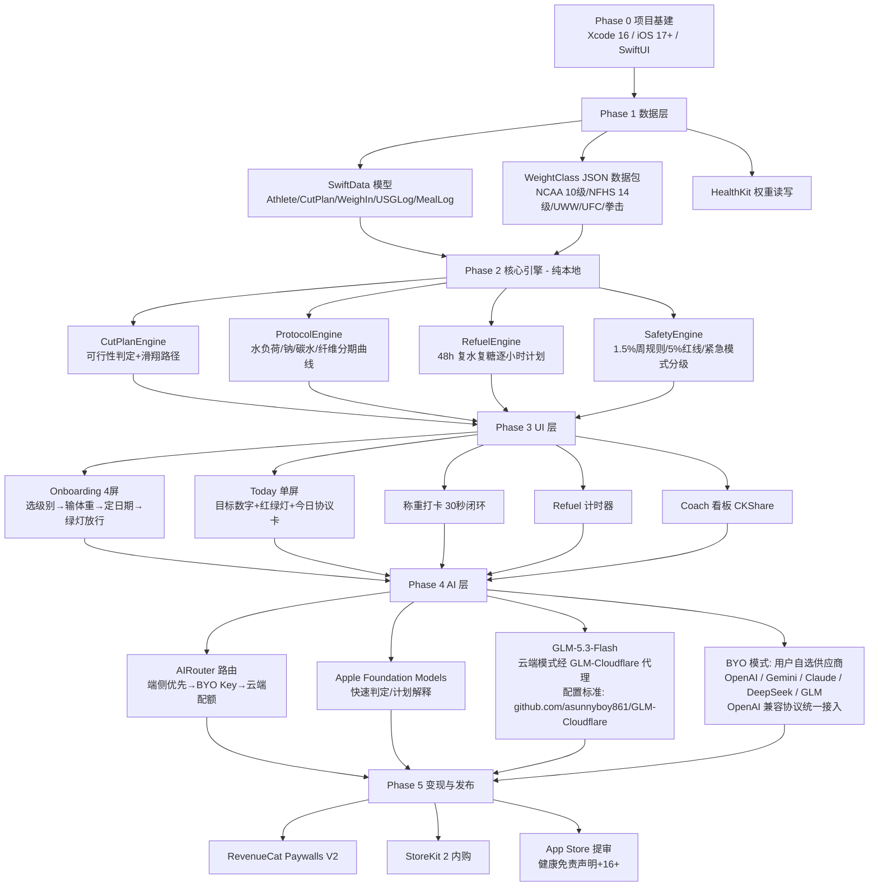
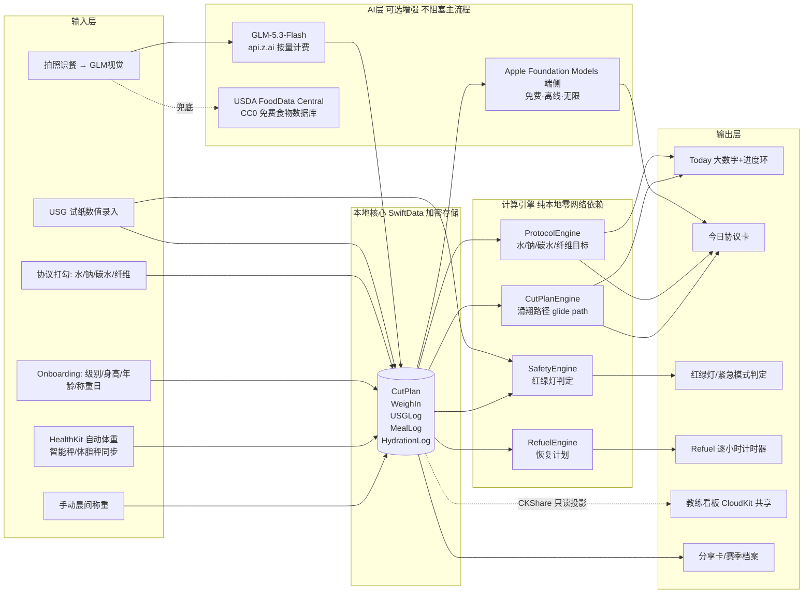

# TR-20260930-格斗减重（CutSzn）- 操作指南

> **文档目的**：任何 LLM / 开发者阅读本文档后，可以完整复刻出一款极具竞争优势的 iOS 格斗减重 App。
> **对标产品**：CutCoach（$20K/月，2026-04 Starter Story 验证）、Makeweight、Fighterr、FightCampWizard
> **目标市场**：🇺🇸 美国（高中/大学摔跤 + BJJ/MMA/拳击）
> **文档日期**：2026-09-30

---

## ⭐ App 命名与副标题（写在最上面）

| 项目 | 内容 |
|---|---|
| **App 名称** | **CutSzn** |
| **副标题（Subtitle，30字符内）** | `Make Weight. Stay Strong.` |
| **完整商店名（Name+Subtitle 组合）** | CutSzn — Make Weight. Stay Strong. |
| **类别** | Health & Fitness（健康健美） |
| **年龄分级** | 12+（涉及减重话题，需健康免责声明） |

### 命名分析（为什么是 CutSzn）

| 维度 | 分析 |
|---|---|
| **品牌记忆度（最关键）** | "Cut Szn"（= Cutting Season，减重赛季）是美国摔跤/MMA 社区**真实高频俚语**，TikTok/Instagram 上 `#cutszn` 是赛前自然聚集的既有标签。用户看到名字会瞬间会心一笑——"这就是给我这个赛季用的 App"。两个字，一个发音记忆点，零解释成本。 |
| **病毒传播** | 用户发社媒打卡（"Made weight ✅ #CutSzn"）时自带品牌曝光——**品牌名即话题标签**，每次用户分享都是免费获客。这是 CutCoach/Makeweight 等普通命名做不到的。 |
| **ASO 搜索优化** | 副标题覆盖 "Make Weight"（月搜索量高的格斗圈强意图词）、"weight"；关键词字段补齐：weight cut, wrestling, weigh-in, MMA, BJJ, fight camp, hydration, rehydrate。 |
| **功能描述性** | "Cut" 在格斗语境 = 减重（不是剪头发），目标人群 0 歧义。 |
| **情感共鸣** | "Szn" 的俚语拼法代表"我的赛季、我的战役"，归属感强，天然契合青少年摔跤手群体。 |
| **国际化适配** | 纯英文短词，无变音符号，所有语言键盘可输入，logo 设计空间大（秤+闪电/C 图形字）。 |
| **合规与占位验证** | 2026-09-30 检索 App Store / 网络无同名 App（`CutSzn` 无占用）；⚠️ 提交前需在 App Store Connect 再次校验名称可用性。**严禁**使用 CutCoach / Makeweight / Fighterr / FightCampWizard 等已存在名称。 |
| **备选名（若 Connect 校验失败）** | 1）`LastPound`（最后一磅，情感强）2）`WeighDay`（称重日）3）`Cornerman`（场边教练） |

---

## 一、调研总结：痛点、竞品与机会

### 1.1 赛道验证

- CutCoach：**$20,000/月**，6 个月 $60K+，38K 下载，摔跤赛季收入爆发（Starter Story 2026-04）。
- 市场规模：美国高中摔跤 **374,278 人**（NFHS 2024-25，男 30 万+女 7.4 万且 +15% 快速增长）+ NCAA 大学摔跤 + BJJ 约 75-100 万练习者 + MMA/拳击。**减重是制度性刚需**：称重不过 = 不能比赛。
- 付费心理：创始人访谈原话——"you're willing to pay $30 to make weight"（为了称重过关你愿意付 30 美元）。失败代价公开且痛苦，付费毫不犹豫。

### 1.2 竞品盘点（2026-09 实查）

| 竞品 | 定价 | 核心功能 | 弱点 |
|---|---|---|---|
| CutCoach | 免费+订阅：$6.99/周、$59.99 买断 | 个性化减重计划、水合策略、食谱、体重追踪 | 无水合状态(USG)监控、无赛后恢复计划、教练看板空白、周订阅扣费投诉 |
| Makeweight | 免费+Pro（月/年/单赛事通行证） | 晨间滑翔路径、fight-week 协议、AI corner coach、拍照记食 | 无团队/教练端、无 USG 合规检测、恢复协议仅静态指导 |
| Fighterr | 免费+Pro | 每日称重预测、水负荷、桑拿计时、8% rule | 功能单薄、无 AI、无恢复 |
| FightCampWizard | 免费+Pro | 碳水递减/水负荷/钠操控/复水指导 | 无称重追踪闭环、无 AI、无团队 |

### 1.3 用户痛点（按强度排序）

1. **"明天称重今晚还差 1.2kg 怎么办"**——紧急时刻无人指导（社区原话："Gotta be 125 tmrw"，这正是 CutCoach 的买量素材）。
2. **安全盲区**：脱水剂量效应（失水 2% → 力量 -3~5%；3% → -7~10%）；1997 年三名 NCAA 摔跤手因极端减重死亡后，NFHS/NCAA 强制尿比重检测（USG≤1.025 / ≤1.020）与每周减重 ≤1.5% 体重规则，**但没有任何竞品把 USG 检测和合规做成产品**。
3. **称重后反弹恢复无人管**："Most fighters have a weight cut plan. Far fewer have a rehydration plan."（多数人有减重计划，极少人有复水计划——Combat Dietitian）复水不科学直接毁掉第二天的比赛表现（糖原耗尽 → 反应慢、决策差）。
4. **教练/团队场景空白**：CutCoach 自己验证过 v1 教练端发计划失败、转向运动员直发，但"教练查看队员减重进度"的需求真实存在（美国摔跤是教练主导的团队运动）。
5. **减重方法靠口传**："for years he was 'just winging it'"（多年全靠瞎搞——职业营养师访谈）；水负荷/钠/碳水/纤维的数字没人说得准。
6. **订阅疲劳与扣费 distrust**：类目普遍 $6.99/周硬墙，差评集中在"先扣费后体验"。

### 1.4 我们的碾压策略（一句话）

> **免费给到竞品付费才有的完整科学协议 + 竞品都没有的三张王牌（安全合规引擎 USG / 48 小时复水恢复 / 教练团队看板）+ 双 AI 角落教练（Apple 端侧免费无限 + GLM-5.3-Flash 拍照识别与深度推理）**

---

## 二、产品定义

### 2.1 一句话

**CutSzn 是格斗选手的"称重导航仪"**：告诉选手今天早上该多少斤、今天喝水吃盐吃碳水的精确数字、称重前还差多少该干什么、称重后每一小时怎么把状态吃回来——并且保证整个过程中不出安全事故。

### 2.2 核心功能矩阵（对比竞品）

| 功能 | CutCoach | Makeweight | **CutSzn** |
|---|---|---|---|
| 晨间滑翔路径（今天该多少） | ✅付费 | ✅免费 | ✅**免费** |
| 完整 fight-week 协议（水/钠/碳水/纤维） | ✅付费 | ✅免费 | ✅**免费** |
| 安全可行性判定（>5% 拒绝+分级警告） | ❌ | ⚠️基础 | ✅**三级红绿灯+紧急模式** |
| USG 尿比重合规检测记录（NFHS/NCAA） | ❌ | ❌ | ✅**独有** |
| 48h 复水恢复计划（逐小时 Refuel 计时器） | ❌ | ⚠️静态 | ✅**动态计时器** |
| AI 角落教练（Can I eat this?） | ❌ | ✅付费 | ✅**Apple 端侧免费层可用** |
| 拍照识餐（钠/碳水精确分解） | ✅付费 | ✅付费 | ✅GLM 视觉（Pro） |
| 教练团队看板 | ❌ | ❌ | ✅**CKShare 独有** |
| Made Weight 病毒分享卡 | ❌ | ❌ | ✅**独有** |
| 最低付费门槛 | $6.99/周 | Pro 月付 | **核心永远免费，Pro 年 $49.99** |

---

## 三、实现流程图（开发实现视角）



**开发周期**：核心（Phase 0-3）2-3 周；AI 层 +1 周；教练看板 +1 周。总 4-5 周 MVP 完整体。

---

## 四、用户使用流程图（极端重要：爽文级体验）

设计总纲：**"打开 → 一个数字 → 完事"**。用户 95% 的使用场景只看一个数字（今天早上该多少磅）。全流程 4 屏完成 onboarding，日常打卡 30 秒。

```mermaid
flowchart TD
    S[首次打开] --> O1[屏1：选项目+体重级别<br/>Wrestling NCAA/NFHS · BJJ · MMA · Boxing<br/>点两下就完]
    O1 --> O2[屏2：输当前体重+身高+年龄<br/>HealthKit 一键导入]
    O2 --> O3[屏3：定称重日<br/>日历选一天]
    O3 --> O4{屏4：红绿灯放行}
    O4 -->|🟢 绿灯 可行| H[主页 Today<br/>"You're on the glide path"]
    O4 -->|🟡 黄灯 极限| H2[警告+条件放行<br/>列出必须遵守的硬规则]
    O4 -->|🔴 红灯 危险| R[拒绝+给出替代方案<br/>建议升一级别/推迟赛事]
    H & H2 --> D[每日循环 - 30秒]
    subgraph D [每天只做一件事]
        D1[晨起上秤 → 输入或HealthKit同步] --> D2[Instant 判定：领先/达标/落后 X 磅<br/>进度环+一句话指令] --> D3[今日协议卡：喝水X L/钠X g/碳水X g<br/>打勾即记录] --> D4[21:00 提醒明早数字<br/>锁屏 Widget 常驻]
    end
    D --> W{进入 Fight Week<br/>最后7天}
    W --> W1[协议升级：水负荷曲线<br/>逐日水量卡片]
    W --> W2[USG 试纸自检打卡<br/>对照 NFHS/NCAA 红线]
    W --> W3{最后24-48h<br/>紧急模式}
    W3 -->|差<2%| E1[🟡 Stage 1 微调模式<br/>控水+低渣饮食清单]
    W3 -->|差2-5%| E2[🟠 Stage 2 汗蒸模式<br/>桑拿/热浴轮次计时+安全上限]
    W3 -->|差>5%| E3[🔴 Stage 3 拒绝服务<br/>硬红线：建议弃赛或升级别<br/>拒绝提供任何极端方案]
    E1 & E2 --> V[✅ MADE WEIGHT 时刻<br/>全屏庆祝动画]
    V --> F[称重后 Refuel 模式<br/>逐小时复水复糖计时器<br/>第1小时: 500-750ml 电解质液<br/>目标: 24h 回到行走体重2-3%内]
    F --> G[比赛日 → 赛后]
    G --> P[生成 Made Weight 分享卡<br/>减重曲线图+成绩<br/>#CutSzn 一键发 IG/TikTok<br/>病毒传播钩子]
    P --> T[赛季档案<br/>本季减重全记录<br/>下次 cut 自动参考历史数据]
```

### 爽感设计要点（把"看爽文"的体验做进产品）

1. **一个数字统治一切**：Today 页只有一个大数字（今天该多少磅）+ 一个进度环 + 一句话（"领先 0.8 lbs，今晚正常喝水"）。零学习成本。
2. **即时正反馈**：每次打卡立刻给判定动画（✅ On Track 绿光扫过）；落后时给的是具体动作而不是焦虑（"今晚多喝 500ml，明早回到线上"）。
3. **红绿灯信任感**：绿灯=放心大胆跟着走；红灯=App 替你踩刹车。**敢拒绝用户**是安全类产品最强的信任卖点，也是竞品不敢做的差异化。
4. **Made Weight 仪式感**：称重过关瞬间全屏庆祝 + 可分享的成绩卡（这是用户人生高光时刻，分享欲极强 → 自带获客飞轮）。
5. **零弹窗零广告**：免费层也不塞广告——口碑即增长。

---

## 五、软件数据流图（极端重要：真实可靠，不虚假）

### 5.1 核心数据流



### 5.2 数据正确性设计（不易出错的关键）

| 风险点 | 防错设计 |
|---|---|
| 重复称重 | 同一天多次称重取**晨起空腹第一次**为有效值，其余标记仅供参考；HealthKit 与手动录入按时间戳去重（同源同分钟只留一条） |
| 单位混乱 | 内部统一存储 **kg**（Double，3位小数），UI 层按用户设置显示 lbs/kg；秤导入自动识别 |
| 计划漂移 | 每次新称重触发 `planRecalibrate()`：滑翔路径以**实际体重**重算剩余天数曲线，而不是死守初始计划 |
| 隐私数据 | 体重/USG/饮食全部 SwiftData 本地 + 用户可选 iCloud 私有库加密同步；**不上传任何自有服务器**；教练看板是用户主动 CKShare 邀请、教练只读 |
| AI 依赖 | 主流程（滑翔路径/协议/红绿灯/Refuel）**100% 本地确定性计算**，AI 只做增强（识餐/问答），断网不影响核心功能 |
| GLM 配额 | 客户端本地计数 + RevenueCat entitlement 双重校验；免费层 Apple 端侧 AI 不计费不受限 |
| 健康安全 | SafetyEngine 硬编码红线：单周减重 >1.5% 体重=黄牌警告；急性水切 >5%=红牌拒绝；USG>1.030=强制补水警告。红线不因付费解锁（合规免责底线） |

### 5.3 减重科学协议参数表（内置算法依据，研发必读）

| 阶段 | 参数 | 依据 |
|---|---|---|
| 水负荷期（赛前3-7天起） | 100ml/kg/天 × 3天，随后递减 3.5L→2.5L→1.5-2L，最后24h <500ml | 运动科学共识（渐进式方案） |
| 钠操控 | 赛前10天正常偏高，**3天前归零**（可贡献 2-3% 体重） | 常见协议 |
| 碳水操控 | 赛前5-7天降至 <100g/天（糖原每克结合 3-3.5g 水，可释放 1-2kg） | 糖原-水结合系数 |
| 纤维操控 | 赛前48h 切低渣饮食 | 胃肠道排空 |
| 汗蒸收尾 | 每次10-15分钟+冷却间歇，单日 ≤30-45 分钟，仅最后1-2天 | NCAA 1997 改革红线 |
| 合规线 | NFHS：USG≤1.025，男体脂≥7%/女≥12%（2026-27 女 19%）；NCAA：USG≤1.020，周减重≤1.5% | NFHS 2026-27 / NCAA WMP |
| 复水 | 补失水量 **150%**；首小时 500-750ml ORS（钠1000-2000mg/L）；碳水 1-1.2g/kg/h，总量 7-10g/kg；目标 12-24h 内回到行走体重 2-3% 以内；含钠液留滞效率比纯水高 25-35% | Shirreffs 1996 / ACSM / UFC PI 指南 |
| 脱水代价 | 失水2%→力量-3~5%；3%→-7~10%；5%+→-10~15% | Judelson 2007 |

---

## 六、核心技术实现（代码示例 + 编写规则 + 二开参考）

### 6.1 技术栈

- **SwiftUI + SwiftData**（iOS 17+，本地优先）· **HealthKit**（体重自动同步）· **CloudKit CKShare**（教练看板）· **Swift Charts**（曲线）· **WidgetKit**（锁屏今日数字）· **StoreKit 2 + RevenueCat**（变现）· **Foundation Models framework**（Apple 端侧 AI，iOS 26）· **GLM-5.3-Flash via `https://api.z.ai`**（OpenAI 兼容协议）

### 6.2 可二次开发的开源项目清单（License 已核验）

| 用途 | 项目 | License | 可复用点 |
|---|---|---|---|
| 整体架构骨架 | github.com/quakeob/fuel-ios | MIT | SwiftUI+SwiftData+HealthKit 卡路里App，含离线USDA SQLite、条码扫描 |
| 体重打卡模块 | github.com/diogot/MyWeight | MIT | 轻量体重记录交互范式 |
| SwiftData+CloudKit 避坑 | Traveling-Snails wiki（INTEGRATION_PATTERNS_GUIDE） | MIT | 属性必须有默认值、关系必须可选、禁 #Unique、手动 actor 替代 @ModelActor |
| TDEE/BMR 算法 | github.com/aadifit/tdee-calc | MIT | Mifflin-St Jeor 等公式+测试用例，直接移植 Swift |
| 教练看板底座 | github.com/apple/cloudkit-sample-sharing | MIT（官方） | CKShare 创建/邀请/权限完整实现 |
| 付费墙模板 | github.com/RevenueCat/cat-paywall-swiftui | MIT（官方） | 订阅+付费墙+Customer Center 全套 UI |
| 纯 StoreKit2 方案 | RevenueCat-Samples/storekit-views-demo-app | MIT | 不用RC时用 SubscriptionStoreView |
| 营养数据库 | USDA FoodData Central API | CC0 公共领域 | 碳水/纤维/钠查询（免费key，1000次/h） |
| ⚠️License 红线 | evroon/bracket、OpenNutriTracker 等 | GPL-3.0 | **只可借鉴思路，禁止拷代码** |

### 6.3 体重级别数据包（自建 JSON，事实数据无版权）

```json
{
  "org": "NCAA",
  "genders": ["M"],
  "classes_lbs": [125, 133, 141, 149, 157, 165, 174, 184, 197, 285],
  "weighIn": "1-2h-before",
  "usgLimit": 1.020,
  "weeklyLossCapPct": 1.5
},
{
  "org": "NFHS",
  "genders": ["M", "F"],
  "classes_lbs": [106, 113, 120, 126, 132, 138, 145, 152, 160, 170, 182, 195, 220, 285],
  "weighIn": "day-before",
  "usgLimit": 1.025,
  "weeklyLossCapPct": 1.5
},
{
  "org": "IBJJF",
  "classes_kg": {"M_gi": [-64, -69, -76.5, -82.3, -88.3, -94.3, -100.5, "+100.5"],
                 "F_gi": [-48.5, -53.5, -58.5, -64, -69, -74, -79.3, "+79.3"]},
  "weighIn": "right-before"
}
```
> 开发规则：JSON 放 Bundle + 远端可更新（赛季规则变化，如 NFHS 2026-27 女子体脂改 19%）；UWW/UFC/职业拳击级别同理补齐。

### 6.4 核心引擎代码示例

#### CutPlanEngine —— 可行性判定 + 滑翔路径

```swift
import Foundation

struct CutPlanInput {
    let currentWeightKg: Double
    let targetWeightKg: Double
    let weighInDate: Date
    let org: WeightClassOrg          // .ncaa / .nfhs / .ibjjf / .ufc ...
    let sex: Sex
    let age: Int
    let heightCm: Double
    let walkWeightKg: Double         // 近30天平均体重
}

enum Verdict { case green, yellow(rules: [String]), red(reason: String) }

struct CutPlan {
    let verdict: Verdict
    let glidePath: [DayTarget]       // 每天 "今天该多少 kg"
    let protocolCurve: ProtocolCurve // 水/钠/碳水/纤维每日目标
}

enum CutPlanEngine {
    // Mifflin-St Jeor（移植自开源 aadifit/tdee-calc，MIT）
    static func bmr(_ i: CutPlanInput) -> Double {
        let base = 10 * i.currentWeightKg + 6.25 * i.heightCm - 5 * Double(i.age)
        return i.sex == .male ? base + 5 : base - 161
    }

    static func evaluate(_ input: CutPlanInput, now: Date = .now) -> CutPlan {
        let days = Calendar.current.dateComponents(
            [.day], from: Calendar.current.startOfDay(for: now),
            to: Calendar.current.startOfDay(for: input.weighInDate)).day ?? 0

        let totalCutPct = (input.currentWeightKg - input.targetWeightKg) / input.currentWeightKg * 100
        let weeklyCap = input.org.weeklyLossCapPct          // 1.5%
        let acuteCap = 5.0                                  // 急性水切红线（>5% 有致死案例）

        let verdict: Verdict
        if totalCutPct > acuteCap {
            verdict = .red(reason: String(
                format: "This cut is %.1f%% of your body weight — above the 5%% safety limit. Move up a class or postpone.", totalCutPct))
        } else if totalCutPct > weeklyCap * Double(max(days, 1)) / 7.0 * 100 {
            verdict = .yellow(rules: [
                "Water load strictly per protocol — no skipping",
                "USG check every morning: NFHS ≤1.025 / NCAA ≤1.020",
                "Sauna only final 48h, ≤30 min/day",
            ])
        } else {
            verdict = .green
        }
        // 滑翔路径：脂肪期线性缓降 + fight week 急性段
        return CutPlan(verdict: verdict,
                       glidePath: buildGlidePath(input, days: days),
                       protocolCurve: ProtocolCurve.build(input, days: days))
    }
}
```

#### ProtocolCurve —— 水/钠/碳水/纤维分期曲线

```swift
struct DayTarget { let date: Date; let targetWeightKg: Double; let isFightWeek: Bool }

struct ProtocolCurve {
    var waterML: [Int]        // 每日饮水 ml
    var sodiumMG: [Int]       // 每日钠 mg
    var carbsG: [Int]         // 每日碳水 g
    var fiberG: [Int]         // 每日纤维 g

    static func build(_ i: CutPlanInput, days: Int) -> ProtocolCurve {
        let n = max(days, 1)
        var water = Array(repeating: 0, count: n)
        var sodium = Array(repeating: 5000, count: n)   // 正常偏高起
        var carbs = Array(repeating: 250, count: n)
        var fiber = Array(repeating: 30, count: n)
        for d in 0..<n {
            let daysOut = n - d                          // 距称重天数
            switch daysOut {
            case 7...:                                   // 水负荷期
                water[d] = Int(i.currentWeightKg * 100)  // 100ml/kg
            case 4...6:                                  // 递减期
                water[d] = [3500, 2500, 2000][min(6 - daysOut, 2)]
                sodium[d] = 1500
            case 2...3:                                  // 钠归零+碳水限制
                water[d] = 1500; sodium[d] = 0; carbs[d] = 80
            case 1:
                water[d] = 400; sodium[d] = 0; carbs[d] = 50; fiber[d] = 10
            default:                                     // 称重日
                water[d] = 0; sodium[d] = 0; carbs[d] = 0; fiber[d] = 0
            }
            if daysOut <= 2 { fiber[d] = min(fiber[d], 12) }  // 48h 低渣
        }
        return ProtocolCurve(waterML: water, sodiumMG: sodium, carbsG: carbs, fiberG: fiber)
    }
}
```

#### RefuelEngine —— 48 小时复水复糖逐小时计划

```swift
struct RefuelStep: Identifiable {
    let id = UUID()
    let hourOffset: Int          // 称重后第几小时
    let title: String            // "Electrolyte load"
    let detail: String           // "Drink 500-750ml ORS (1000-2000mg sodium/L)"
    let fluidML: Double?
    let carbsG: Double?
}

enum RefuelEngine {
    /// fluidLostKg = 行走体重 - 称重体重；weighInFormat = 当日称重(赛前1-2h) 或 前一日称重
    static func build(fluidLostKg: Double, weighInFormat: WeighInFormat) -> [RefuelStep] {
        let fluidML = fluidLostKg * 1500          // 补失水量 150%（Shirreffs）
        let carbPerHour = 1.2                     // g/kg/h
        var steps: [RefuelStep] = [
            .init(hourOffset: 0, title: "First 60 min", detail: "Sip 500–750ml ORS. Small, frequent mouthfuls.",
                  fluidML: 700, carbsG: fluidLostKg * 25),
            .init(hourOffset: 1, title: "Keep loading", detail: "Sodium fluids absorb 25–35% better than plain water.",
                  fluidML: fluidML * 0.2, carbsG: fluidLostKg * 30),
            .init(hourOffset: 4, title: "Real food + salt", detail: "Rice, pasta, salted potatoes. Low fiber today.",
                  fluidML: fluidML * 0.2, carbsG: fluidLostKg * 35),
            .init(hourOffset: 8, title: "Carb top-up", detail: "Target 7–10g carbs per kg lost, total.",
                  fluidML: fluidML * 0.15, carbsG: fluidLostKg * 30),
            .init(hourOffset: 12, title: "Sleep prep", detail: "Final 300–500ml sodium fluid. Wake lighter.",
                  fluidML: 400, carbsG: nil),
            .init(hourOffset: 24, title: "Weigh-in check", detail: "Goal: within 2–3% of walk weight.",
                  fluidML: nil, carbsG: nil),
        ]
        if weighInFormat == .dayBefore {
            steps += [
                .init(hourOffset: 36, title: "Game-day breakfast", detail: "High carb, familiar foods only. Nothing new.",
                      fluidML: 500, carbsG: fluidLostKg * 20),
                .init(hourOffset: 44, title: "Final load", detail: "Stop large fluids 2h before match; small sips after.",
                      fluidML: 300, carbsG: fluidLostKg * 15),
            ]
        }
        return steps
    }
}
```

#### AIRouter —— Apple 端侧优先 + GLM 兜底（见第八章详细策略）

```swift
enum AISource { case appleOnDevice, byo(BYOSettings), glmCloud(quota: Int) }

/// BYO 设置：用户在设置页自选供应商，端点+Key+模型名全部可配置（不写死任何一家）
/// 拍照识餐要求所选模型具备视觉能力；纯文字模型仅可用于 Corner Coach
struct BYOSettings: Codable {
    var provider: String        // "openai" / "gemini" / "claude" / "deepseek" / "glm" / 自定义
    var baseURL: URL            // OpenAI 兼容端点（Gemini/Claude 均提供兼容层）
    var apiKey: String          // Keychain 存储
    var model: String           // 如 glm-4.6v / gpt-4o-mini / gemini-2.0-flash / deepseek-vl 等
    var supportsVision: Bool
}

final class AIRouter {
    func route(task: AITask) async -> AIResult {
        // 1) 快速判定类（"Can I eat this?"）→ Apple Foundation Models：免费/离线/无限
        if task.isQuickVerdict, let r = await AppleAI.run(task) { return r }
        // 2) 拍照识餐 / 深度推理：BYO Key 无限用（任意供应商），否则走云端配额（默认 GLM-5.3-Flash）
        switch task.source {
        case .byo(let s) where s.supportsVision || !task.needsVision:
            return await OpenAICompatClient(settings: s).run(task)   // 统一 OpenAI 兼容协议
        case .glmCloud(let quota) where quota > 0: 
            return await GLMClient.cloud(task)   // 服务端校验 RevenueCat entitlement
        default: 
            return AppleAI.fallback(task) ?? .upsell  // 引导升级但不阻塞核心功能
        }
    }
}
```

#### GLM-5.3-Flash 调用示例（OpenAI 兼容，国际版 `https://api.z.ai/api/paas/v4/chat/completions`）

> ⚠️ 以下为**参考实现骨架**。实际接入时：Key 保管、Cloudflare 代理端点与配置标准以 `https://github.com/asunnyboy861/GLM-Cloudflare` 配置文档为准（云端配额模式应经该 Cloudflare 代理转发并由服务端校验 entitlement，不要把官方 Key 打进客户端二进制）；BYO Key 模式下客户端直连**用户自选供应商**的端点（下方示例同样适用于 OpenAI/Gemini/Claude/DeepSeek——统一 OpenAI 兼容请求体，仅 baseURL/model 不同）。

```swift
struct GLMClient {
    let apiKey: String
    // 端点以 GLM-Cloudflare 配置文档为准：云端模式=代理端点；BYO 模式=用户所选供应商端点（可配置）
    let endpoint = URL(string: "https://api.z.ai/api/paas/v4/chat/completions")!

    func run(_ task: AITask) async throws -> AIResult {
        var messages = task.messages   // system prompt 内置减重协议上下文（体重/滑翔路径/今日协议）
        if let image = task.imageJPEG {  // 拍照识餐：base64 视觉输入
            messages.append(.init(role: .user, content: [
                .text("Identify every food item. Output JSON: {items:[{name,carbs_g,sodium_mg,fiber_g,kcal}],verdict:\"eat|avoid|portion\"}"),
                .imageBase64(image.base64EncodedString(), format: "jpeg"),
            ]))
        }
        var req = URLRequest(url: endpoint)
        req.httpMethod = "POST"
        req.setValue("application/json", forHTTPHeaderField: "Content-Type")
        req.setValue("Bearer \(apiKey)", forHTTPHeaderField: "Authorization")
        req.httpBody = try JSONEncoder().encode(GLMRequest(
            model: "glm-4.6v-flash-2",   // 以 https://docs.bigmodel.cn 最新型号表为准，按需切换推理/视觉档
            messages: messages, temperature: 0.3, maxTokens: 800))
        let (data, _) = try await URLSession.shared.data(for: req)
        return try JSONDecoder().decode(AIResult.self, from: data)
    }
}
```

### 6.5 编写规则（LLM 复刻时必须遵守）

1. **主流程零 AI 依赖**：滑翔路径/协议/红绿灯/Refuel 是确定性算法，AI 只是增强层——保证断网可用、结果可复现（健康类产品正确性 > 智能感）。
2. **SwiftData + CloudKit 兼容规则**（来自 Traveling-Snails 实战 wiki）：每个 @Model 属性必须有默认值；所有关系必须声明为可选；禁用 `#Unique`；用自定义 actor 而非 @ModelActor。
3. **单位统一 kg 内部存储**，UI 层转换 lbs；日期统一 `startOfDay` 计算。
4. **红线逻辑写死不可被付费绕过**（App Review 健康类合规底线 + 诉讼风险隔离）；所有页面带 "Not medical advice" 免责声明；16+ 分级。
5. **RevenueCat entitlement 管理所有付费态**，云端 GLM 调用必须服务端二次校验（防客户端破解白嫖 API）。
6. HealthKit 只申请体重/身体成分最小权限；隐私政策声明"数据不离开设备或 iCloud 私有库"。
7. 每次新称重自动触发 `planRecalibrate()`；同日多次称重取首次空腹值。

---

## 七、AI 集成方案（Apple AI + GLM-5.3-Flash 组合）

> 用户已具备：① Apple small account → **免费使用 Apple Intelligence API**（Foundation Models framework，端侧）；② GLM-5.3-Flash API（支持视觉识别 + 推理 + 文字）。智谱双平台：国内 BigModel（`open.bigmodel.cn`，人民币）+ 国际版 Z.ai（`api.z.ai`，美元）——**Key 体系已统一，BigModel Key 可直接在 api.z.ai 端点使用**。本 App 面向美国 → 全部走 `api.z.ai`。API 文档：`https://docs.bigmodel.cn`。
> **GLM API 与配置文档（权威来源）**：`https://github.com/asunnyboy861/GLM-Cloudflare` —— GLM-5.3-Flash 的 API Key 保管、Cloudflare 代理配置与配置标准均以该仓库文档为准（⚠️ 该仓库为私有/需授权访问，匿名访问 404；复刻时向产品所有者获取访问权限）。前端（iOS 端）集成时按该配置文档与配置标准接入，并使用**配套的 GLM API skill** 处理添加 GLM API 等——生成代码时直接调用该 skill 的标准配置，无需自行约束模型样式。

### 7.1 分工原则：免费的尽量免费，付费的物超所值

| 任务 | 用谁 | 为什么 |
|---|---|---|
| "Can I eat this?" 快速判定 | **Apple Foundation Models（端侧）** | 高频（每天多次）、需要离线可用（称重周经常在场馆）、零边际成本 → **免费层可用+付费后无限** |
| 今日协议解释/鼓励话术 | **Apple 端侧** | 零成本高频，免费层体验"AI 教练感" |
| **拍照识餐**（钠/碳水/纤维精确分解） | **GLM-5.3-Flash 视觉** | 精度要求高（钠含量差 500mg 就影响 protocol）；Apple 端侧模型视觉精度不足，**必须用 GLM 才能碾压竞品的识餐能力** |
| **深度 Corner Coach 对话**（结合完整数据上下文的推理："今晚还差 1.1kg 我该怎么办"） | **GLM-5.3-Flash 推理** | 需要真推理能力；Apple 端侧回答质量不足以碾压 Makeweight 的 AI coach |
| 计划重建/复盘分析 | Apple 端侧出草稿 → 可选 GLM 校验 | 成本分层 |

### 7.2 成本与配额设计（GLM 是消耗品，严禁买断无限调用）

- 免费层：Apple 端侧 AI **每天 5 次**快判 + 全部本地功能 → 引流并体验 AI。
- Pro 订阅（含云端 AI 配额）：Apple 端侧 AI **无限**；GLM 拍照识餐 **30 次/月**；Corner Coach **60 条/月**（实际成本每条约 $0.001 量级，配额远超成本但防滥用）。
- Pro BYO（买断）：用户粘贴自己的任意供应商 Key（**OpenAI / Google Gemini / Anthropic Claude / DeepSeek / GLM(Z.ai) 等均可**，统一 OpenAI 兼容协议）→ 对应 AI **无限次**（成本用户自担），Apple AI 亦无限 → 支持一次性买断（合规：买断不含我们承担的 API 消耗）。
- 单赛事通行证：30 天有效，含固定 GLM 配额（100 次识餐 + 200 条 coach）——按赛事周期付费，天然契合赛季爆发的消费习惯。

### 7.3 GLM API 配置标准（GLM-Cloudflare，复刻必读）

| 事项 | 标准 |
|---|---|
| **配置文档权威来源** | `https://github.com/asunnyboy861/GLM-Cloudflare`（私有仓库，需产品所有者授权访问）——API Key 保管、Cloudflare Worker 代理部署、端点与鉴权配置均以该仓库文档为准 |
| **客户端接入方式** | 云端配额模式：App → GLM-Cloudflare 代理端点（Key 只存在服务端，客户端永不接触官方 Key）；BYO Key 模式：用户自有 Key + **自选供应商端点**（OpenAI 兼容协议统一接入，不写死任何一家） |
| **生成流程** | 前端生成/修改 GLM 相关代码时，使用**配套的 GLM API skill**（与该配置文档、配置标准一一匹配）来处理添加 GLM API——按 skill 内置的标准配置生成即可，不需要额外约束模型样式 |
| **配额扣减位置** | 在 Cloudflare 代理层完成（结合 RevenueCat entitlement 服务端校验），客户端只收到"成功/配额不足"结果，防篡改 |
| **失败降级** | 代理超时/5xx → 自动重试 1 次 → 仍失败则降级到 Apple 端侧 AI 或提示稍后再试（拍照识餐允许队列重传，参考 Makeweight 差评修复经验："Photo scans retry automatically when a connection drops"） |

### 7.3.1 BYO 多供应商参考表（设置页预置模板，用户可自定义）

| 供应商 | baseURL（OpenAI 兼容端点） | 视觉能力 | 备注 |
|---|---|---|---|
| GLM / Z.ai | `https://api.z.ai/api/paas/v4` | ✅ | 云端默认引擎；模型名以 `docs.bigmodel.cn` 为准 |
| OpenAI | `https://api.openai.com/v1` | ✅ | 原生 OpenAI 协议 |
| Google Gemini | `https://generativelanguage.googleapis.com/v1beta/openai` | ✅ | 官方 OpenAI 兼容层 |
| Anthropic Claude | `https://api.anthropic.com/v1`（OpenAI 兼容层） | ✅ | 注意部分兼容层对图像消息格式有差异，需适配 |
| DeepSeek | `https://api.deepseek.com/v1` | 按型号 | 文字模型可跑 Corner Coach；识餐需选视觉型号 |
| 自定义 | 任意 OpenAI 兼容端点 | 用户勾选 | 兼容 OpenRouter/本地中转等 |

> 设计规则：BYO 设置页 = 供应商模板下拉 + baseURL/model/Key 三个可编辑字段 + "视觉能力"开关；Key 存 Keychain；识餐任务若所选模型无视觉能力则引导切换或降级 Apple 端侧。

---

## 八、价格策略（详细分析，策略 = 免费 + 站内订阅B + BYO 买断混合）

### 8.1 定价总表

| 档位 | 价格 | 内容 | 战略意图 |
|---|---|---|---|
| **Free（引流层）** | $0 | 完整滑翔路径、完整 fight-week 协议（水/钠/碳水/纤维）、晨间称重打卡、红绿灯安全判定、USG 记录、Refuel 计时器、Apple 端侧 AI 5次/天、1 个活跃 cut 计划 | **竞品付费才有的核心全免费**——用 Tarsi 逻辑：免费层就把问题解决，靠口碑+分享卡获客；"App 真有用"是转化的前提 |
| **Pro Monthly** | **$9.99/月** | Apple AI 无限 + GLM 识餐 30 次/月 + Corner Coach 60 条/月 + 无限 cut 计划 + 教练看板(单人) + 锁屏 Widget 主题 | 摔跤赛季 11-2 月集中爆发，月付承接短周期用户 |
| **Pro Yearly** ⭐主推 | **$49.99/年**（7天免费试用） | 同上全部 + 年度减重档案 | 对标 CutCoach $59.99 买断价：**"比对手买断还便宜，还是订阅制的全部 AI"**；主推档 |
| **Single-Cut Pass** | **$14.99 / 30天** | 一场比赛全功能 + GLM 100次识餐 + 200条 coach | 契合"只为这场比赛付费"心理（创始人验证：愿付 $30 make weight）；**不定订阅**，无扣费焦虑 → 差评区反杀 |
| **Pro BYO（买断）** | **$34.99 一次性** | 永久解锁全部非 AI 功能 + 粘贴自有任意供应商 Key（GLM/OpenAI/Gemini/Claude/DeepSeek 等均可，BYO 设置页可配）后 AI 无限 + Apple AI 无限 | 满足讨厌订阅人群 + 支付榜打法；**API 消耗由用户自担，可合规买断** |
| **Coach 端（B2B）** | **$99.99/年**（最多 30 名队员） | 团队看板：全员滑翔路径状态、红绿灯预警、USG 合规报表（NFHS/NCAA 合规证明）、落后名单推送 | 摔跤俱乐部/高中校队预算；教练是天然采购决策者；CutCoach 已放弃的空白场景 |

### 8.2 定价逻辑分析

1. **为什么不学 CutCoach 收 $6.99/周**：周订阅是类目差评重灾区（"先扣费后体验"信任危机）。我们用"免费核心+明码标价+单赛事通行证"把差评区变成获客文案（参考全局方法论：透明定价是把差评区变成获客文案的万能打法）。
2. **为什么 GLM 功能必须订阅/配额而禁止买断**：GLM API 是按量消耗品，买断=亏损无底洞。解法：① 订阅内含月配额；② BYO Key 模式下可无限买断（用户自担成本）；③ Apple 端侧 AI 承诺付费后无限（零边际成本，合规且是卖点）。
3. **年费 $49.99 心理学**：低于竞品 $59.99 买断价锚点 + 每天 $0.14 = "一瓶水钱保你称重过关"；7 天试用覆盖一场赛前减重的完整体验周期。
4. **收入结构预估**：赛季月付+年费为主力，Single-Cut Pass 承接 impulse 购买，BYO 承接极客，Coach $99.99/年 每 50 名运动员可带来 1-2 个教练单（B 端溢价）。对标 CutCoach $20K/月（38K 下载），我们免费层转化面更大，$25-30K/月 是合理目标。

---

## 九、UI 设计规范（美国市场 + 主流趋势）

1. **风格**：Apple Health / 혈 Fitness 风格的原生 SwiftUI 设计（美国用户 2026 主流审美 = 原生感、大字号数字、暗色优先）。主色：**电光绿 #00E676**（on track 状态色=品牌色）+ 深黑背景 + 警示琥珀/红。大圆角卡片（20pt）、SF Symbols 图标、Dynamic Type 全适配。
2. **Today 页（唯一主页）**：顶部大数字（今天该多少 lbs，96pt 等宽字体）+ 进度环 + 红绿灯横幅 + 今日协议卡（水/钠/碳水三个打勾环）。**无 tab 迷宫**：底部仅 3 个 tab（Today / Plan / Team）。
3. **交互**：称重打卡 = 大键盘输入 lbs 或 HealthKit 自动；一切操作 ≤2 次点击；触觉反馈（打卡成功 UINotificationFeedbackGenerator.success）。
4. **Widget**：锁屏 inline widget 常驻 "Tomorrow: 129.4 lbs"——把产品钉在用户每天必看的界面。
5. **本地化**：仅英文（美国市场）；lbs 为默认单位（kg 可切）。
6. **无障碍**：VoiceOver 全支持（健康类产品 App Review 加分项）。
7. **分享卡**：Made Weight 成绩卡 = 深色底 + 大绿勾 + 减重曲线 + 赛事名，右下角 CutSzn 水印 + `#CutSzn`——为 Instagram Story/TikTok 比例（9:16）设计。

---

## 十、上线清单与 ASO

- **App Store 关键词**：weight cut, make weight, wrestling, weigh in, MMA, BJJ, fight camp, cutting weight, hydration, rehydrate, fight week
- **截图顺序**（转化率关键）：① Today 大数字+红绿灯 → ② 滑翔路径曲线 → ③ Refuel 计时器 → ④ 拍照识餐 → ⑤ Made Weight 分享卡 → ⑥ 教练看板
- **宣传语**："The weight cut your coach would write — if your coach did the math."（翻译：像教练亲手写的减重计划——如果你的教练会算数的话）
- **合规必备**：16+ 分级；健康免责声明（"not medical advice, cutting weight carries risks"）在 onboarding 和付费墙双展示；不采集健康数据用于广告；Privacy Manifest（HealthKit 类目必填）。
- **发布节奏**：对准摔跤赛季（美国高中 11 月开赛，1-2 月州锦标赛=收入峰值），**10 月底上线**，11 月 TikTok/Reddit（r/wrestling, r/bjj）内容投放 + #CutSzn 标签运营。

---

## 十一、给 LLM 复刻的最终检查清单

- [ ] App 名 CutSzn，副标题 "Make Weight. Stay Strong."（提交前在 App Store Connect 复验名称）
- [ ] Onboarding 4 屏 + 红绿灯放行逻辑（green/yellow/red 三档）
- [ ] CutPlanEngine / ProtocolCurve / RefuelEngine / SafetyEngine 四引擎纯本地实现
- [ ] 体重级别 JSON（NCAA/NFHS/IBJJF/UFC 至少 4 套）
- [ ] HealthKit 体重读写 + 同日去重
- [ ] SwiftData 本地存储 + 可选 iCloud 私有库
- [ ] CKShare 教练看板（基于 apple/cloudkit-sample-sharing）
- [ ] AIRouter：Apple 端侧优先 → BYO Key（多供应商，OpenAI 兼容协议）→ 云端配额（GLM-5.3-Flash 经 GLM-Cloudflare 代理）
- [ ] GLM-5.3-Flash 接入走 `https://api.z.ai`（美国市场），视觉+推理，文档 `https://docs.bigmodel.cn`
- [ ] RevenueCat：Free / Pro 月 $9.99 / Pro 年 $49.99 / Single-Cut $14.99 / BYO 买断 $34.99 / Coach $99.99
- [ ] 红线逻辑不可被付费绕过 + 全程免责声明
- [ ] 锁屏 Widget + Made Weight 分享卡（#CutSzn）
- [ ] **⚠️ 需向产品所有者索要 GLM-5.3-Flash API Key**（付费功能依赖该 API，见第七/八章）
- [ ] **GLM API 配置以 `https://github.com/asunnyboy861/GLM-Cloudflare` 配置文档为准**（Key 保管 / Cloudflare 代理端点 / 配置标准；前端生成时使用配套 GLM API skill 的标准配置，见 7.3 节）

---

*数据来源：CutCoach 创始人访谈（Better Launch / Starter Story 2026-04）、App Store 竞品页（CutCoach / Makeweight / Fighterr / FightCampWizard）、NFHS 2024-25 Participation Survey、NCAA Weight Management Program、Combat Dietitian、Shirreffs 1996、Judelson 2007、GitHub 开源项目（fuel-ios / tdee-calc / cloudkit-sample-sharing / cat-paywall-swiftui 等）。*
